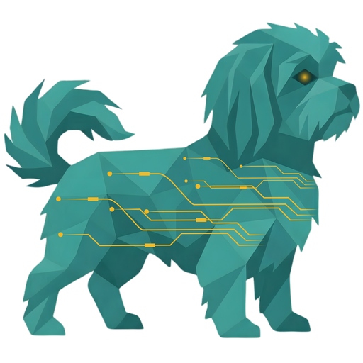

# Ennea for Codex

Work with your manufacturing operations from Codex. Explore your Ennea workspace,
prepare individual or batch changes, review them in Ennea, and inspect the results.
The plugin connects to Ennea's hosted MCP server and includes **Setup** and
**Work with Ennea** skills.

## Install and connect

Add the public Ennea marketplace source in Codex:

```text
https://github.com/AlaaSubora/ennea-codex-plugin
```

Select **Ennea** from that marketplace and install it. Connect your Ennea account
through the browser sign-in flow. In Ennea, choose the workspace, actions, and
record types you want to allow. Then run the plugin's Setup skill to check the
connected workspace and available operations.

You can also register the marketplace and install the plugin with Codex CLI:

```sh
codex plugin marketplace add AlaaSubora/ennea-codex-plugin --ref main
codex plugin add ennea@ennea
```

The public repository contains the plugin package and marketplace. Anyone can
fetch it without an Ennea repository account. Access to manufacturing data requires
an Ennea account with the appropriate permissions.

This repository marketplace is a direct installation source. Publication in the
universal ChatGPT and Codex plugin directory requires a separate OpenAI review;
this repository does not claim that directory approval or publication.

## Use Ennea with your agent

Try:

- “Show what I can work with in Ennea.”
- “Prepare these materials as one change set for review in Ennea.”
- “Show the validation issues and help me repair this proposal.”
- “Check whether my approved changes finished applying.”

Your agent explores and transforms source data in its own environment. It submits
native structured operations to Ennea individually or in batches. Ennea validates
the operations, creates a proposal, and provides a review link. You review the
drafts in Ennea before they can be applied. Agents cannot approve their own
proposals. The agent checks execution status and reads back results before
reporting completion.

## Connection and permissions

The hosted MCP endpoint is `https://api.ennea-ai.com/mcp`. OAuth supports these
actions: read, prepare, stage, and apply after human review. Your consent and current
Ennea permissions determine the allowed actions and record types. Every request
remains bound to the workspace and environment chosen during connection.

Codex manages the OAuth credentials. Access tokens last fifteen minutes and
refresh automatically. A connection lasts at most thirty days and remains bound
to the issuing Ennea browser session. Signing out, session expiry, revocation, or
permission changes can end access earlier. Reconnect through Codex to choose a
different workspace or change consent. Revoke access in Ennea under
**Agents → Agent access**.

## Help

- [Ennea website](https://www.ennea-ai.com/)
- [Support and frequently asked questions](https://www.ennea-ai.com/faq/)
- [Ennea contact details](https://www.ennea-ai.com/impressum/)
- [Privacy policy](https://www.ennea-ai.com/privacy/)
- [Terms of service](https://www.ennea-ai.com/terms/)

## Deutsch

Arbeite direkt in Codex mit deinen Fertigungsabläufen. Erkunde deinen
Ennea-Arbeitsbereich, bereite einzelne Änderungen oder ganze Pakete vor und prüfe
die Ergebnisse. Das Plugin enthält die Skills **Setup** und **Work with Ennea**
und verbindet sich mit dem gehosteten MCP-Server von Ennea.

Füge in Codex die öffentliche Marketplace-Quelle hinzu:

```text
https://github.com/AlaaSubora/ennea-codex-plugin
```

Installiere **Ennea** aus diesem Marketplace und verbinde dein Ennea-Konto über
die Anmeldung im Browser. Wähle in Ennea den Arbeitsbereich, die erlaubten Aktionen
und die Datensatztypen. Führe anschließend den Setup-Skill aus, um die Verbindung
und die verfügbaren Aktionen zu prüfen. Die oben gezeigten Codex-CLI-Befehle sind
ebenfalls verfügbar.

Das öffentliche Repository enthält das Plugin und den Marketplace. Du brauchst
keinen Zugang zum Ennea-Quellcode. Für Fertigungsdaten benötigst du ein Ennea-Konto
mit den passenden Berechtigungen. Eine Veröffentlichung im allgemeinen
Plugin-Verzeichnis von ChatGPT und Codex erfordert eine gesonderte Prüfung durch
OpenAI; dieses Repository behauptet keine solche Freigabe oder Veröffentlichung.

Dein Agent verarbeitet Quelldaten in seiner eigenen Umgebung und übergibt
strukturierte Änderungen einzeln oder als Paket. Ennea validiert die Änderungen
und stellt einen Link zur Prüfung bereit. Prüfe die Entwürfe in Ennea, bevor du
sie anwendest. Ein Agent kann seine eigenen Vorschläge nicht freigeben. Er prüft
den Ausführungsstatus und liest die Ergebnisse erneut, bevor er die Arbeit als
abgeschlossen meldet.

Codex verwaltet die OAuth-Zugangsdaten. Deine Auswahl bei der Verbindung und deine
aktuellen Ennea-Berechtigungen begrenzen den Zugriff. Die Verbindung endet
spätestens nach dreißig Tagen oder früher, wenn deine Ennea-Sitzung endet oder du
den Zugriff widerrufst. Verbinde dein Konto erneut, um den Arbeitsbereich oder die
erlaubten Aktionen zu ändern. Widerrufe den Zugriff unter
**Agenten → Agentenzugriff**.

Hilfe findest du in den [häufigen Fragen](https://www.ennea-ai.com/faq/) und über
die [Ennea-Kontaktdaten](https://www.ennea-ai.com/impressum/).

## Package reference

- [Official plugin packaging and marketplaces](https://developers.openai.com/plugins/build/plugins)
- [Official MCP authentication documentation](https://developers.openai.com/plugins/build/auth)
- [Official plugin submission process](https://developers.openai.com/plugins/deploy/submission)
